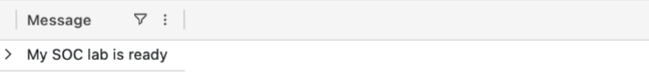
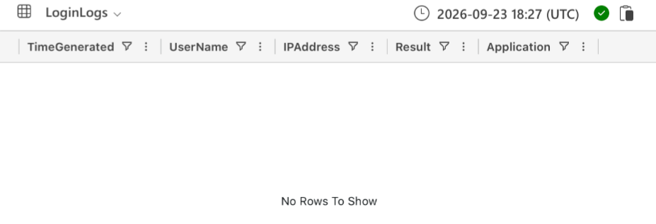
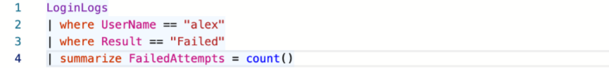
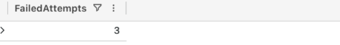
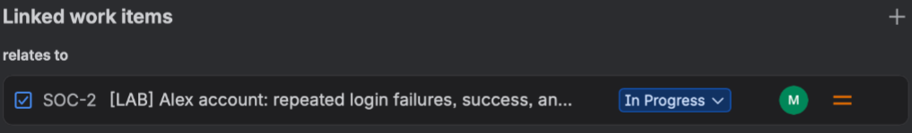
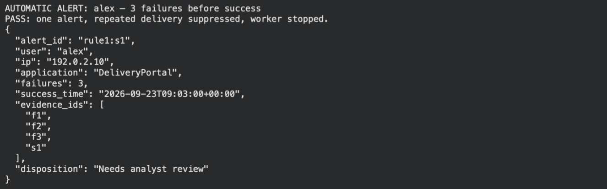
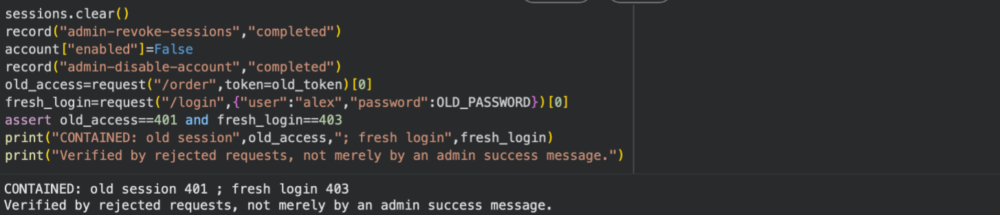
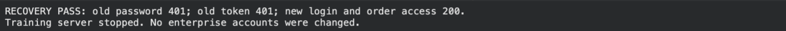

# SOC Identity Investigation Lab — From Suspicious Login to Verified Recovery

**KQL Investigation · Jira Case Ownership · Python Detection and Response**

Oluwaseyi Michael Falode | Cybersecurity & Cloud Security Engineer | Toronto, ON | September 2026


---

Three failed passwords are followed by a successful login. An order is viewed. A customer-data export is denied. Was this an authorised user struggling with a password, or access by someone else?

This project follows that question through a complete **training workflow**: prepare telemetry, investigate with KQL, document the case in Jira, implement a sequence-based detector, replay events into an alert worker, and verify containment and recovery in an isolated Python application.

**Verified local result:** all **10 detector scenarios passed**, the replay produced **one alert despite repeated delivery**, and response checks rejected the old session and disabled-account login. Recovery kept old credentials blocked while restoring new access.

> **Training scope:** all scenario users, addresses, orders, and events are fictional. Azure/Jira investigation and Python response are separate environments. The notebook does not read Azure, update Jira, or administer an identity provider. Screenshots below are extracted from the supplied walkthrough; fresh local validation is recorded separately.

## Project at a Glance

| | |
|---|---|
| **Investigation platform** | Azure Data Explorer with KQL |
| **Case management** | Jira: main case SOC-2 and linked follow-up SOC-3 in the source narrative |
| **Response environment** | Python standard library; HTTP server bound to `127.0.0.1` |
| **Telemetry** | Six login records and three application records in the documented fixtures |
| **Detection** | Three distinct failures strictly before success within five minutes; same user, IP, application |
| **Validation** | 10 original detector scenarios, plus 13 regression and repository checks |
| **Replay result** | One alert; duplicate success delivery suppressed |
| **Containment result** | Old-token access: 401; fresh login while disabled: 403 |
| **Recovery result** | Old password/token: 401; new login/protected access: 200 |
| **Evidence** | Two original PDFs, eight extracted images, JSON alert and response audit, execution transcripts |
| **Important unknowns** | Actor identity, password acquisition, complete exposure scope, shared session attribution |

## Contents

- [The Problem This Project Solves](#the-problem-this-project-solves)
- [Architecture](#architecture)
- [Phase 1: Prepare the Investigation Workspace](#phase-1-prepare-the-investigation-workspace)
- [Phase 2: Reconstruct the Login and Application Timeline](#phase-2-reconstruct-the-login-and-application-timeline)
- [Phase 3: Own and Document the Case](#phase-3-own-and-document-the-case)
- [Phase 4: Build and Test the Detector](#phase-4-build-and-test-the-detector)
- [Phase 5: Replay Events and Emit an Alert](#phase-5-replay-events-and-emit-an-alert)
- [Phase 6: Contain and Verify](#phase-6-contain-and-verify)
- [Phase 7: Recover and Verify Again](#phase-7-recover-and-verify-again)
- [Results and Evidence](#results-and-evidence)
- [How to Reproduce](#how-to-reproduce)
- [Repository Structure](#repository-structure)
- [Lessons Learned and Limitations](#lessons-learned-and-limitations)
- [Skills Demonstrated](#skills-demonstrated)

## The Problem This Project Solves

An authentication alert is a starting point. Counting failed passwords does not identify the person behind them, establish how a password was obtained, or show whether response controls stopped access.

This lab addresses three practical questions:

1. **Can the analyst explain the evidence?** Reconstruct the sequence, compare authentication with application activity, and separate facts from hypotheses.
2. **Does the detection behave as intended?** Test ordering, time boundaries, duplicate delivery, and a legitimate pattern that still matches.
3. **Did the response change access?** Establish a working baseline, apply controls, and test both rejected old access and successful new access.

The case remains deliberately small so another reader can inspect each record and reproduce every Python result. Its value is the reasoning and verification process, not a claim of enterprise-scale detection coverage.

## Architecture

```text
DOCUMENTED INVESTIGATION                   EXECUTABLE PYTHON LAB
------------------------                   ---------------------
6 synthetic login records                  4-event Alex fixture
3 synthetic application records                       |
            |                              Sequence detector + 10 checks
Azure Data Explorer / KQL                              |
            |                              Queue replay + duplicate suppression
Timeline, counts and pivots                            |
            |                              JSONL alert: Needs analyst review
Jira SOC-2 <--> SOC-3
Evidence, hypotheses, follow-up             Separate loopback training app
                                                      |
                                           Baseline login + order access
                                                      |
                                           Revoke sessions + disable account
                                                      |
                                           Verify rejected access paths
                                                      |
                                           Reset + enable + verify recovery
                                                      |
                                           JSON audit + server shutdown
```

These are related learning exercises, **not an integrated automated response pipeline**. No alert automatically disables an Azure or Jira account. The local response actions are explicit notebook operations.

---

## Phase 1: Prepare the Investigation Workspace

The documented Azure workflow creates a training database, verifies the query editor, and defines `LoginLogs`. The table schema keeps five fields: event time, user, source IP, outcome, and application.

```kusto
print Message = "My SOC lab is ready"
```



*Figure 1 — The original one-row result confirms query execution. Extracted from walkthrough page 5.*

```kusto
.create table LoginLogs (
    TimeGenerated:datetime, UserName:string,
    IPAddress:string, Result:string, Application:string
)
```



*Figure 2 — The table exists with the expected five columns before ingestion. “No Rows To Show” is correct at this stage. Walkthrough page 6.*

The [login CSV](data/login-events.csv) contains six fixture records. [azure-queries.kql](code/azure-queries.kql) provides numbered blocks for creation, ingestion, counting, timeline review, and application pivots.

**Implementation detail:** `.ingest inline` appends data. Run it once in an empty lab table and expect `LoginLogs | count` to return six. A second ingestion produces duplicates; repeating it is not a repair for a delayed count result. All scenario timestamps are fixed, so relative “last 24 hours” filters are unsuitable for replaying the historical fixture.

## Phase 2: Reconstruct the Login and Application Timeline

The initial question is narrow: how many failed events are recorded for Alex?

```kusto
LoginLogs
| where UserName == "alex"
| where Result == "Failed"
| summarize FailedAttempts = count()
```





*Figures 3–4 — The original query and its result establish a failure count of three. They do not independently establish a time window or successful login afterward. Both images come from walkthrough page 8.*

The timeline query supplies the ordering needed to interpret the fixture:

```kusto
LoginLogs
| where UserName == "alex"
| order by TimeGenerated asc
```

| Time, UTC — 23 September 2026 | Fixture record | Analyst interpretation |
|---|---|---|
| 09:00, 09:01, 09:02 | Three failures from `192.0.2.10` | Repeated unsuccessful authentication; actor undetermined |
| 09:03 | Successful login to DeliveryPortal | Access succeeded; MFA and actor identity are not established |
| 09:04 | `ViewOrder`, Order-1042, Success | An order view is recorded |
| 09:05 | `ExportCustomerData`, CustomerDirectory, Denied | This recorded export attempt was blocked |
| 09:06 | `Logout`, Session, Success | A logout is recorded; all-session revocation is not established |

The remaining login rows are Maya's success and Ben's failure. They provide context; the fixture does not establish a wider campaign.

**Correlation limit:** `LoginLogs` and `ApplicationLogs` have no common session ID. Matching user and nearby times supports further investigation, but cannot prove that a particular authenticated session performed every application action. The application rows are supplied fixture data; a separate live query screenshot was not captured.

### From a count to a candidate detection

```kusto
LoginLogs
| where TimeGenerated >= datetime(2026-09-23T09:00:00Z)
| where TimeGenerated < datetime(2026-09-23T09:10:00Z)
| summarize
    Failures = countif(Result == "Failed"),
    Successes = countif(Result == "Success")
  by UserName, IPAddress, Application
| where Failures >= 3 and Successes >= 1
```

This query identifies groups with both outcomes in the interval. **It does not enforce failure-before-success.** The Python rule in Phase 4 adds that sequence requirement. Running the KQL manually also does not deploy a scheduled SIEM alert.

## Phase 3: Own and Document the Case

The source narrative records a main Jira case, SOC-2, and a follow-up, SOC-3, investigating the access method. Linking them preserves the relationship between the incident question and the work needed to answer it.



*Figure 5 — A saved “relates to” relationship points to SOC-2. The case is visibly In Progress; this is not evidence of final closure. Walkthrough page 13.*

A useful case note separates four categories:

| Category | Example for this lab |
|---|---|
| **Observed in supplied records** | Three failures followed by success; order view; denied export |
| **Hypothesis** | Legitimate password errors, guessing, phishing, or reused credentials |
| **Unknown** | Who authenticated, how the password was acquired, complete exposure scope |
| **Next action** | Obtain authentication details, device evidence, and shared session identifiers |

The optional expired MFA exception and `LAB-SESSION-001` belong to the tabletop scenario. They were not retrieved from a live identity provider. The [case study](docs/case-study.md) expands the competing explanations; the [response playbook](docs/response-playbook.md) includes a reusable case-note template and decision gates.

## Phase 4: Build and Test the Detector

**Rule shape:** sequence and threshold, evaluated per successful authentication.

| Rule field | Definition |
|---|---|
| Grouping | Same user, source IP, and application |
| Threshold | At least three distinct failed events |
| Window | Inclusive five-minute lower boundary; strict upper boundary before success |
| Input deduplication | Event ID |
| Alert identity | `rule1:` plus successful event ID |
| Disposition | `Needs analyst review` |

The central predicate is deliberately inspectable:

```python
success["time"] - timedelta(minutes=5) <= failure["time"] < success["time"]
```

An event exactly five minutes before success qualifies. An event with the same timestamp as success does not: its ordering is not established. The full implementation is in [cell-01.py](code/cell-01.py); the [detection specification](docs/detection-specification.md) explains its assumptions and failure modes.

### Original ten-scenario test matrix

| Scenario | Expected alerts | What it checks |
|---|---:|---|
| Three failures then success | 1 | Positive matching sequence |
| One typo then success | 0 | Below threshold |
| Failures without success | 0 | Success is required |
| Success before failures | 0 | Ordering matters |
| Failures outside five minutes | 0 | Window enforcement |
| Repeated copies of one failure | 0 | Duplicates cannot inflate the count |
| Earliest failure exactly five minutes before success | 1 | Inclusive lower boundary |
| Failures and success with equal timestamps | 0 | Strict upper boundary |
| Success from another IP | 0 | Source isolation |
| Legitimate repeated typos with the same sequence | 1 | A rule match is not proof of malicious intent |

**Result:** all ten checks passed in the fresh local execution. This measures behaviour on these fixtures; it is not a production precision, recall, or false-positive-rate measurement.

## Phase 5: Replay Events and Emit an Alert

Cell 3 puts the four Alex events into a queue, then repeats the success event. A worker evaluates accumulated history and keeps a set of emitted alert IDs. The repeated delivery should not produce a second alert.



*Figure 6 — The original replay emitted one alert, suppressed repeated delivery, and stopped its worker. Walkthrough page 17. The new local execution independently reproduced this result.*

The resulting [JSONL alert](evidence/local-validation/project1_alerts.jsonl) preserves the evidence IDs:

```json
{
  "alert_id": "rule1:s1",
  "user": "alex",
  "ip": "192.0.2.10",
  "application": "DeliveryPortal",
  "failures": 3,
  "success_time": "2026-09-23T09:03:00+00:00",
  "evidence_ids": ["f1", "f2", "f3", "s1"],
  "disposition": "Needs analyst review"
}
```

**Operational limit:** this is a short synthetic replay. History and suppression state live in memory, disappear on restart, and are not bounded for long-running use. A production service would need durable state, retention, event validation, and an explicit late-arrival policy.

## Phase 6: Contain and Verify

The response demonstration starts a separate local HTTP application with `/login` and a protected `/order` route. Before changing controls, the code verifies login and order access both return 200. That baseline matters: a broken server should not be mistaken for successful containment.

Containment performs two distinct actions:

```python
sessions.clear()              # Invalidate sessions in this training app
account["enabled"] = False    # Prevent a fresh login
```

It then tests the access paths the controls should block:

| Request after containment | Expected and observed | Meaning within this application |
|---|---:|---|
| Order request with the old token | 401 | The old session is no longer accepted |
| Fresh login while the account is disabled | 403 | Disabled-account login is blocked |



*Figure 7 — Actual request failures verify the tested controls, beyond an administrative success message. Walkthrough page 19.*

Clearing sessions affects every session in this small application's store. It does not revoke real identity-provider tokens. The fixture has one training account and no hardened administrative API.

## Phase 7: Recover and Verify Again

The final cell replaces the disposable password hash, re-enables the training account, and checks both negative and positive paths.

| Recovery check | Expected and observed |
|---|---:|
| Old password | 401 |
| Old token | 401 |
| New password login | 200 |
| Protected order with new token | 200 |



*Figure 8 — Recovery keeps tested old access blocked and restores new access; the training server then stops. Walkthrough page 20.*

The [response audit](evidence/local-validation/project1_response_audit.json) records the local sequence. Audit timestamps belong to the execution, while detection events retain the fixed scenario date. No enterprise MFA, device remediation, or identity-provider recovery was performed.

---

## Results and Evidence

| Deliverable | Where to inspect it | Status |
|---|---|---|
| Nine-page investigation narrative | [Investigation PDF](docs/Project1-SOC-Investigation.pdf) | Original, unchanged |
| 35-page build-along guide | [Walkthrough PDF](docs/Project1-SOC-Walkthrough.pdf) | Original, unchanged |
| KQL and CSV fixtures | [Queries](code/azure-queries.kql), [data](data/README.md) | Packaged; not re-executed in Azure during repository review |
| Six executable Python cells | [Notebook](notebooks/Project1-Walkthrough.ipynb), [code](code) | Locally executed and checked |
| Detector and response results | [Validation transcript](evidence/local-validation/validation.txt) | Fresh local execution |
| Additional regression checks | [Regression report](evidence/local-validation/regression.txt) | Separate from the original ten scenarios |
| Source/figure provenance | [Evidence register](docs/evidence-register.md), [image register](screenshots/README.md) | Source pages and limitations documented |
| Technical and analyst decisions | [Detection specification](docs/detection-specification.md), [case study](docs/case-study.md) | Inspectable rationale |

The eight images above are extracted embedded figures, not recreated screenshots. Original standalone screenshot files were not supplied. The selected evidence does not show final Jira closure, so this repository does not claim it.

## How to Reproduce

### Option A — Run locally

**Prerequisites:** Python 3.9+; no external Python dependencies, cloud accounts, credentials, or package installation required for the Python lab.

```bash
git clone https://github.com/seyifalode-cmd/soc-identity-investigation-lab.git
cd soc-identity-investigation-lab
python3 code/run_lab.py
```

The runner creates `runs/latest/`, executes the six cells in order, and closes the server on exit. To save a separate run:

```bash
python3 code/run_lab.py runs/my-review
```

Expected summary lines:

```text
10 checks passed. A matching pattern still needs investigation.
PASS: one alert, repeated delivery suppressed, worker stopped.
BEFORE containment: login 200; protected order access 200.
CONTAINED: old session 401 ; fresh login 403
RECOVERY PASS: old password 401; old token 401; new login and order access 200.
Training server stopped. No enterprise accounts were changed.
```

Generated files: `project1_alerts.jsonl` and `project1_response_audit.json`. Do not use `-O`; the runner rejects optimized mode because it would remove verification assertions.

### Option B — Run in a notebook

Upload [Project1-Walkthrough.ipynb](notebooks/Project1-Walkthrough.ipynb) to Colab or open it in Jupyter. Run the six cells sequentially in one runtime. The notebook intentionally has no stored outputs. Save the generated JSON files before discarding the runtime. The loopback URL belongs to that runtime; in Colab, it is not a URL to open on your laptop.

### Option C — Rebuild the Azure and Jira investigation

Follow the [walkthrough PDF](docs/Project1-SOC-Walkthrough.pdf), pages 4–14, using your own training workspaces. Run each numbered KQL block separately. Ingest once, verify six login rows, inspect Alex's sequence, then review the three application records. Create and own a case, link the follow-up, and document facts and uncertainty. Your case keys will differ.

### Check the repository

```bash
python3 validation/check_project.py
```

This runs additional detector boundary/isolation cases, checks notebook/code agreement and PDF hashes, verifies fixture counts and local Markdown targets, executes the complete lab in a temporary directory, and checks exported artifacts. See [validation/README.md](validation/README.md) for scope and the [troubleshooting guide](docs/troubleshooting.md) for common failures.

## Repository Structure

```text
soc-identity-investigation-lab/
├── README.md
├── code/
│   ├── azure-queries.kql              # Numbered Azure commands and queries
│   ├── cell-01.py ... cell-06.py      # Detector, tests, replay, response, recovery
│   └── run_lab.py                    # Local execution with cleanup
├── data/
│   ├── login-events.csv              # Six synthetic login records
│   └── application-events.csv        # Three synthetic application records
├── notebooks/
│   └── Project1-Walkthrough.ipynb    # Same six cells, clean outputs
├── screenshots/                      # Eight embedded figures extracted from PDF
│   └── README.md                     # Page-level provenance and limitations
├── validation/
│   ├── check_project.py              # Regression and repository checks
│   └── README.md
├── evidence/
│   ├── source-manifest.json          # Original PDF hashes
│   └── local-validation/             # Transcripts, replay alert, response audit
└── docs/
    ├── Project1-SOC-Investigation.pdf
    ├── Project1-SOC-Walkthrough.pdf
    ├── case-study.md
    ├── detection-specification.md
    ├── evidence-register.md
    ├── response-playbook.md
    └── troubleshooting.md
```

## Lessons Learned and Limitations

- **A count is not a sequence.** The initial KQL summary and Python detector answer different questions; their coverage should not be presented as identical.
- **A correct match can be benign.** Taylor's repeated-typo scenario needs corroboration, not automatic account disablement based only on the threshold.
- **A denied export is a narrow finding.** It does not establish that no data was viewed, exposed elsewhere, or accessed in another session.
- **Session correlation needs session evidence.** User and time proximity cannot replace a shared identifier.
- **Response needs functional tests.** Check existing sessions and fresh authentication, then repeat negative and positive checks during recovery.
- **Event integrity is an assumption here.** Conflicting event IDs use last-record-wins behaviour in the teaching detector; input is not schema-validated.
- **The app is a teaching fixture.** It omits real MFA, session expiry, persistent storage, hardened request handling, and enterprise access controls.

Next improvements would be shared session IDs, conflicting-ID rejection, persistent alert state, bounded replay history, and evaluation on a labelled dataset. These are future work; no precision/recall claims are made.

## Skills Demonstrated

**Security investigation:** KQL filtering and aggregation, event ordering, source-IP pivots, application-activity review, and competing-hypothesis analysis.

**Case ownership:** a main investigation with linked follow-up, explicit unknowns, reusable notes, and evidence-based closure criteria.

**Detection engineering:** sequence/threshold design, event-ID deduplication, time-boundary tests, grouping isolation, and replay alert suppression.

**Response verification:** baseline establishment, session invalidation, account disablement, negative access testing, and verified recovery in a local application.

**Technical communication:** a reproducible notebook, copyable queries, evidence provenance, documented limitations, and a reviewer-friendly portfolio narrative.

---

*Oluwaseyi Michael Falode · Cybersecurity & Cloud Security Engineer · Toronto, ON · September 2026*

[GitHub](https://github.com/seyifalode-cmd) · [LinkedIn](https://www.linkedin.com/in/oluwaseyi-falode-bb3b1651/)
