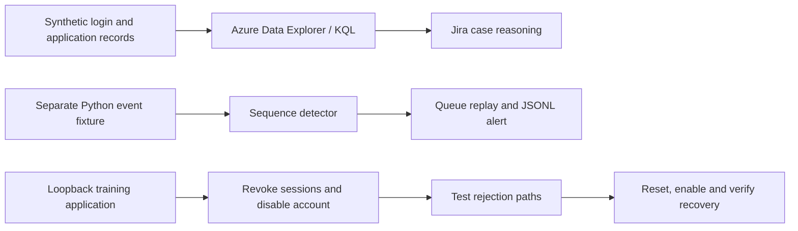

# From Suspicious Login to Verified Recovery

**A SOC investigation portfolio by Oluwaseyi Falode**

Three failed passwords. One successful sign-in. A denied export. This lab follows the evidence from a suspicious authentication pattern through investigation, case documentation, detection, containment, and recovery.

**Scope:** fictional users and events. Azure Data Explorer and Jira support the documented investigation; a separate Python application demonstrates response controls. This repository does not connect to an identity provider or modify enterprise accounts.

## Start here

- [Investigation narrative](docs/Project1-SOC-Investigation.pdf) — the nine-page portfolio story.
- [Step-by-step walkthrough](docs/Project1-SOC-Walkthrough.pdf) — the original 35-page build guide.
- [Runnable notebook](notebooks/Project1-Walkthrough.ipynb) — six reconstructed cells, ready to upload to Colab or run in Jupyter.
- [Analyst case study](docs/case-study.md) — conclusions, competing explanations, and evidence gaps.
- [Evidence register](docs/evidence-register.md) — source provenance and fresh local validation.
- [Response playbook](docs/response-playbook.md) — decision points and verification criteria.

## Reproduce the Python lab

Python 3.9+ and its standard library are sufficient. No API keys or package installation are needed. From the repository root:

```bash
python3 code/run_lab.py
```

The runner creates `runs/latest/`, executes all six cells, and stops the loopback HTTP server even if a cell fails. Do not use Python's `-O` flag: the lab uses assertions as checks.

Expected results:

| Check | Expected outcome |
|---|---|
| Detector scenarios | 10 checks passed |
| Synthetic replay | One alert; repeated success delivery suppressed |
| Baseline | Login 200; protected order access 200 |
| Containment | Old token 401; fresh login while disabled 403 |
| Recovery | Old password/token 401; new login/order access 200 |

Outputs are `project1_alerts.jsonl` and `project1_response_audit.json`. A fresh local execution is preserved under [evidence/local-validation](evidence/local-validation). Those results are separate from the original screenshots and their capture dates.

For the browser route, upload the notebook to Colab and run cells in order. Notebook outputs are intentionally empty so readers generate their own evidence. For Azure, run the numbered blocks in [azure-queries.kql](code/azure-queries.kql) individually; each ingestion appends records, so ingest once into an empty lab table.

## How the pieces connect



The diagram shows two learning environments. There is no automatic Azure-to-Python or Jira-to-response integration.

## Detection contract

For the same user, IP, and application, find at least three distinct failed events in `[success time - 5 minutes, success time)`. Equal-time failures are excluded. Deduplicate by event ID; emit at most one replay alert per success event ID.

The initial KQL summary counts failures and successes in a fixed interval; it **does not enforce order**. The Python detector enforces ordering. A legitimate repeated-typo scenario deliberately triggers the detector: a matching alert is a review signal, not a verdict.

## What this demonstrates

- KQL filtering, timeline reconstruction, aggregation, and pivots.
- Case ownership and clear separation of facts, assumptions, and hypotheses.
- Boundary testing and duplicate-delivery suppression.
- Functional response verification using both denied and successful requests.
- Reproducible evidence with documented limits.

## Limitations and next improvements

The tables have no common session ID. Password acquisition, complete exposure scope, and final Jira closure are not established. No real MFA, endpoint investigation, or enterprise session revocation was performed.

The detector is a small in-memory teaching implementation: conflicting event IDs overwrite earlier records; replay history is unbounded; alert state is lost on restart; repeated full-history scans do not scale. A production design would need validated schemas, conflict handling, durable checkpoints, bounded state, late-event policy, and measured alert quality. The HTTP application intentionally omits hardened administrative APIs and session expiry. See the [case study](docs/case-study.md) for evidence needed to support stronger conclusions.

## Repository map

```text
code/          Six notebook cells, local runner, numbered KQL blocks
notebooks/     Clean runnable notebook
data/         Synthetic CSV fixtures (see data/README.md)
docs/          Original PDFs and enriched analyst documentation
evidence/      Fresh local execution results and source hashes
```

The original PDFs are preserved unchanged. Added materials reconstruct their companion code and expand the analysis; they do not represent new Azure or Jira activity. No software license has been added on the author's behalf.
